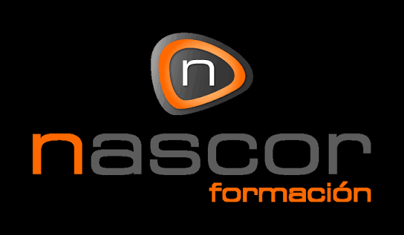
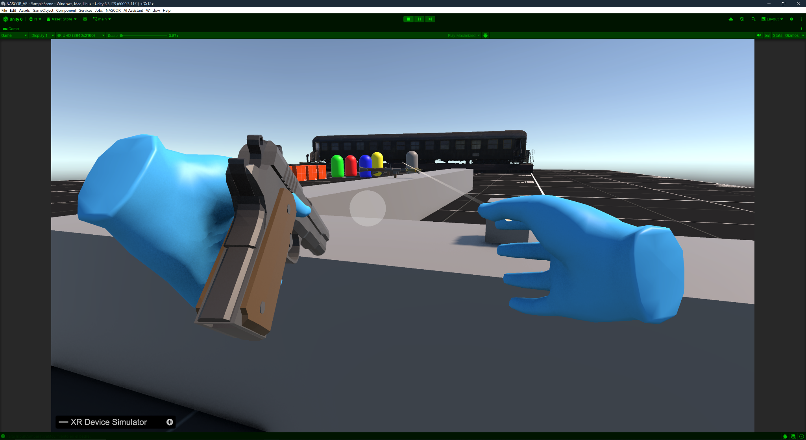
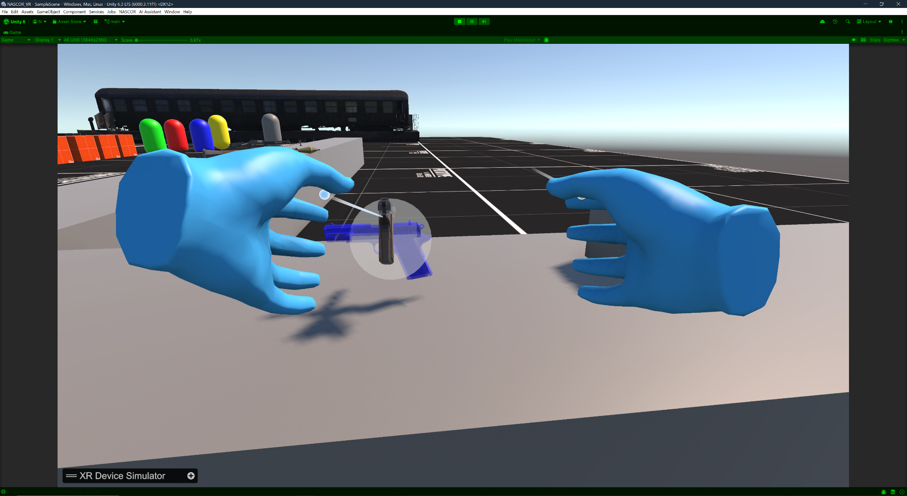
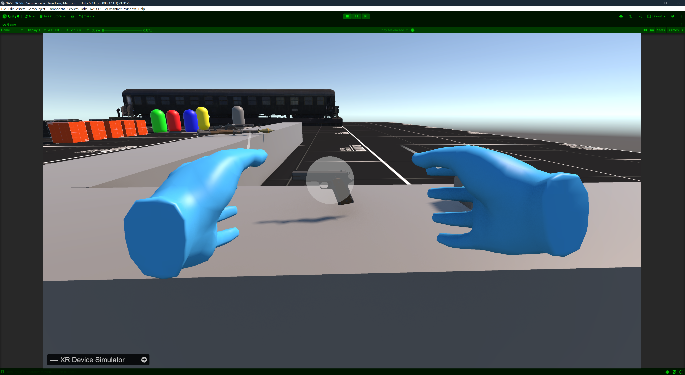

# NASCOR VR — Unity 6 · OpenXR · XR Interaction Toolkit



> Proyecto de aprendizaje y experimentación con realidad virtual en **Unity 6.3 LTS (6000.3.11f1)**. Se ha adaptado una escena 3D existente para utilizar un visor **Meta Quest mediante Quest Link** y probar la misma escena sin gafas con **XR Device Simulator**.

**Estado: prototipo VR funcional en simulador; conexión y renderizado en Meta Quest verificados.** Quedan pendientes ciertos ajustes de punto de aparición y la validación final de los modelos de manos con los mandos físicos.

## Capturas del proyecto

### Agarre directo con manos XR — pistola M1911



El prototipo permite **agarrar la pistola en primera persona** mediante las manos virtuales. El agarre se configura con los interactores de XR Interaction Toolkit y un punto de sujeción en el objeto.

### Interacción y colocación de objetos

| Interacción con la pistola | Zona de acople / socket |
|:---:|:---:|
|  |  |

Estas capturas muestran **interacciones directas, una visualización de objeto seleccionado y el área de detección del acople** en la escena ejecutada con XR Device Simulator. Se mantienen los modelos de manos azules y la mesa de pruebas con varios objetos.

## Estado actual — 31 de octubre de 2026

| Funcionalidad | Estado | Observaciones |
|---|---|---|
| Escena 3D adaptada a VR | ✅ | `SampleScene`, con XR Origin y cámara estereoscópica. |
| XR Device Simulator | ✅ | Permite probar visor y controladores con teclado y ratón. |
| Movimiento continuo | ✅ | Probado con **WASD** en el simulador. |
| Teletransporte | ✅ | Rayo XR, área válida y teleport ejecutándose en el simulador. |
| Modelos de manos y mandos | ✅ | Se alternan visualmente con **V** en el simulador. |
| Agarre directo de pistola M1911 | ✅ Simulador | Probado con las manos virtuales; se muestra en las nuevas capturas. |
| Interacción y zona de acople de pistola | ✅ Visualización | Capturas de selección y del área de detección del socket en el simulador. |
| Meta Quest / Quest Link | ✅ parcial | Se ha conectado el visor y se renderiza la escena desde el Editor. |
| Oculus Touch Controller Profile | ✅ | Añadido a OpenXR para los controladores de Meta Quest. |
| Seguimiento y aspecto de manos con Quest | 🔄 | Pendiente de validación final con ambos mandos físicos. |
| Punto de aparición con visor real | 🔧 | Sigue necesitando ajuste; `PuntoInicioVR`/`InicioVR` se están probando. |
| Limpieza de ejercicios heredados | 🔧 | Revisar mensajes residuales de pruebas anteriores en Console. |
| APK independiente para Quest (Android) | ⏳ | No implementada; actualmente se utiliza Quest Link desde Windows. |

> La tabla distingue lo comprobado en el **simulador** de lo validado con el **visor real**. No se da por terminada la prueba de controladores físicos ni el punto de aparición.

## Tecnología utilizada

- **Unity 6.3 LTS** con **Universal Render Pipeline (URP)**.
- **XR Interaction Toolkit (XRI)**, con **Starter Assets**.
- **XR Plug-in Management** y **OpenXR Plugin**.
- **Input System** de Unity y **Oculus Touch Controller Profile** para los mandos Quest.
- **XR Device Simulator** para desarrollo sin visor físico.
- **Meta Horizon Link / Quest Link** para ejecutar desde el Editor en las gafas.
- **C#** solo para utilidades puntuales: alternar la visualización y seleccionar modos de desarrollo; el teletransporte utiliza componentes oficiales de XRI.

## Organización VR de la escena

La escena conserva sus objetos y ejercicios anteriores. Para VR se añadió un **XR Origin (XR Rig)** basado en los prefabs de Starter Assets y un simulador independiente.

```text
SampleScene
├── Main Camera (original, desactivada)
├── Plane (SueloTeleport + Mesh Collider + Teleportation Area)
├── XR Origin (XR Rig)
│   ├── Camera Offset
│   │   ├── Main Camera (cámara XR)
│   │   ├── Gaze Interactor
│   │   ├── Left Controller
│   │   │   ├── Teleport Interactor
│   │   │   ├── Near-Far Interactor / Poke Interactor
│   │   │   ├── Left Controller Visual
│   │   │   └── Left Hand Model
│   │   ├── Right Controller
│   │   │   ├── Teleport Interactor
│   │   │   ├── Near-Far Interactor / Poke Interactor
│   │   │   ├── Right Controller Visual
│   │   │   └── Right Hand Model
│   └── Locomotion
├── XR Device Simulator
├── PuntoInicioVR (en pruebas)
└── ... resto de objetos NASCOR
```

Los modelos de manos son recursos animados importados del curso. Se colocaron como hijos de sus respectivos controladores y se ajustó su **Transform local** según el prefab original. Los objetos visuales de manos y mandos se activan de forma excluyente sin apagar los interactores.

## Configuración: simulador y gafas reales

Se incorporó una utilidad de Editor (`Assets/Editor/NASCOR_VR_ModosEditor.cs`), cuyo menú se llama **`Gestor XR`**, para alternar sin reconfigurar manualmente cada proveedor XR. **La utilidad es específica del proyecto** y requiere tener los paquetes XR instalados.

| Modo `Gestor XR` | Initialize XR on Startup | Proveedor / visor | Simulador en escena |
|---|---|---|---|
| **1 - Simulador (teclado y ratón)** | OFF | No inicia OpenXR | ON |
| **2 - Meta Quest Link** | ON | OpenXR en Windows | OFF |
| **3 - Mock HMD (experimental)** | ON | Mock HMD | ON |

**Importante:** `Mock HMD` no equivale a `XR Device Simulator`: simula un visor, no los controles y mandos del XRI. La tercera opción es experimental y no se necesita para las pruebas habituales.

### Probar sin gafas

1. Importar `XR Interaction Toolkit > Samples > Starter Assets` y el sample de simulador correspondiente.
2. Tener un único XR Origin y un único XR Device Simulator en la escena.
3. Fuera de Play, seleccionar **`Gestor XR > 1 - Simulador (teclado y raton)`**.
4. Guardar la escena, entrar en Play y utilizar el panel de controles que muestra el XR Device Simulator.
5. Probar desplazamiento continuo, apuntado y teletransporte. Los bindings de simulación pueden cambiar según la versión del sample.

### Probar con Meta Quest mediante Link (Windows)

1. Fuera de Play, seleccionar **`Gestor XR > 2 - Meta Quest Link (gafas reales)`**.
2. Comprobar en `Project Settings > XR Plug-in Management > OpenXR` que está añadido **`Oculus Touch Controller Profile`** para la plataforma Windows.
3. En la aplicación Meta Horizon Link, configurar el **runtime OpenXR activo** (en nuestro equipo ya aparecía como activo).
4. Conectar las Quest por Quest Link y entrar en el entorno de PC VR desde el visor.
5. Pulsar **Play** en Unity; la vista `Left Eye` del Game View muestra una de las dos imágenes estereoscópicas.

No hace falta compilar una APK para esta prueba por Link. La prueba inicial confirmó la **visualización del escenario en las gafas**, no la finalización de todos los controles físicos.

## Movimiento y teletransporte con XR Interaction Toolkit

El sistema se configuró **sin implementar manualmente `Physics.Raycast()` ni mover el jugador con código personalizado**.

| Componente | Función |
|---|---|
| `XR Origin` | Jerarquía que representa al jugador XR, cámara y referencia espacial. |
| `Controller Input Action Manager` | Alterna entre modos de entrada y locomoción de cada controlador. |
| `XR Ray Interactor` | Lanza rayos de interacción mediante el sistema XRI. |
| `XR Interactor Line Visual` + `Line Renderer` | Dibuja el rayo y su respuesta visual. |
| `Teleportation Area` | Define superficies donde está permitido teletransportarse. |
| `Teleportation Provider` | Solicita el desplazamiento XR al sistema de locomoción. |
| `Locomotion Mediator` + `XR Body Transformer` | Coordinación y aplicación de transformaciones del jugador en XRI 3.x. |
| `Near-Far Interactor` / `Poke Interactor` | Interacción próxima, lejana y con interfaces. |

### Suelo válido y dos tipos de capas

El objeto `Plane` utiliza un **Mesh Collider** y la **Layer física** `SueloTeleport`. Su componente `Teleportation Area` permite seleccionar la superficie como destino. La `Interaction Layer Mask` de XRI se configura de forma compatible con la del `Teleport Interactor` (por ejemplo, `Teleport`).

- **`Raycast Mask`:** filtra qué colliders encuentra el rayo físico (`SueloTeleport`).
- **`Interaction Layer Mask`:** filtra qué interactuables XR puede seleccionar el interactor (`Teleport`).
- **`Teleportation Provider`:** ejecuta el desplazamiento cuando se confirma un destino válido.

Un raycast limitado al suelo puede atravesar visualmente objetos de otras capas: es apropiado como demostración, pero debe revisarse en un escenario con paredes y obstáculos.

En `XR Interactor Line Visual` se pueden configurar gradientes para **destino válido** (azul) e **inválido** (rojo). El rayo de teletransporte solo aparece cuando se activa la acción **Teleport Mode**; no debe confundirse con el rayo de interacción normal.

### Controles que se comprobaron

- **WASD**: movimiento continuo durante la prueba con simulador.
- **Acción de joystick de teletransporte del mando derecho**: activación del arco y confirmación, simulada mediante el XR Device Simulator. En la configuración usada se consiguió probar con el modo de controlador y el eje del joystick derecho.
- **V**: alternar entre modelos visuales de manos y mandos con `AlternarManosMandosXR.cs`.
- El script del alternador también tiene un binding previsto para el **botón A** de Oculus Touch; queda por comprobar su comportamiento definitivo con los mandos físicos.

El movimiento continuo y el teletransporte **conviven**; no se ha sustituido uno por el otro.

## Scripts propios añadidos

| Archivo | Propósito |
|---|---|
| `Assets/Editor/NASCOR_VR_ModosEditor.cs` | Menú `Gestor XR`: selecciona simulador, Quest Link y Mock HMD de pruebas. No ejecuta las gafas automáticamente. |
| `Assets/Scripts/AlternarManosMandosXR.cs` | Alterna la visibilidad de los modelos de manos y mandos, dejando interactores y entradas activos. |
| `InicioVR.cs` / `PuntoInicioVR` | Experimento para alinear la cámara con un punto de inicio; **comportamiento con Quest pendiente de corregir**. |

No se incluyen en este repositorio los archivos generados de `Library/`, `Temp/`, `Logs/` ni builds: quedan excluidos mediante `.gitignore`.

## Prácticas recientes: agarre y mecanismos (30–31 de octubre de 2026)

Durante las clases se han trabajado las interacciones físicas de **XR Interaction Toolkit**. **El agarre de la M1911 y las pruebas visuales de colocación/acople ya aparecen en la escena del simulador**, como muestran las capturas anteriores. Otras prácticas (escalado con dos manos, articulaciones y mandos físicos Quest) siguen sin quedar acreditadas por estas imágenes.

| Componente o técnica | Uso y observaciones |
|---|---|
| `XR Direct Interactor` | Interacción por proximidad de las manos; usa una zona de detección, normalmente `Sphere Collider` marcado como **Is Trigger**. |
| `XR Grab Interactable` | Permite agarrar objetos con `Collider` y `Rigidbody`, usando el botón **Grip / Select**. |
| `Movement Type` | Comparación de `Instantaneous`, `Kinematic` y `Velocity Tracking`, con diferente respuesta física. |
| `Attach Transform` | Punto de agarre definido con un GameObject vacío, por ejemplo en la empuñadura de una M1911. |
| `Dynamic Attach` | Ajuste de cómo se conserva la posición de agarre en relación con la mano. |
| `XR General Grab Transformer` | Agarre múltiple y escalado con dos manos, habilitando `Select Mode: Multiple` y **Allow Two Handed Scaling**. |
| `XR Socket Interactor` | Zonas para acoplar una pistola u otro objeto interactuable, normalmente con Collider tipo Trigger. |
| `Hinge Joint`, `Fixed Joint`, `Configurable Joint` | Puertas, uniones físicas y desplazamientos limitados por eje. |
| URP / Render Pipeline Converter | Conversión de materiales incompatibles que aparecen magenta en la escena. |

### Ejercicios de la sesión

- **Cubo escalable:** agarrar con ambas manos, modificar su tamaño y conservar la escala al soltarlo; `Select Mode = Multiple` y un Grab Transformer configurado para el escalado bimanual.
- **Pistola M1911 (probada en simulador):** utilizar un punto de agarre situado sobre la empuñadura y referenciarlo desde `XR Grab Interactable > Attach Transform`. La captura principal muestra la pistola en la mano izquierda.
- **Soporte / socket (pruebas visuales en simulador):** combinar `XR Socket Interactor`, un Collider de detección y una representación visual semitransparente. Las capturas muestran el área de acople y la interacción con la pistola.
- **Deslizamiento limitado:** probar `Configurable Joint` bloqueando X e Y, limitando Z y bloqueando las rotaciones correspondientes.

Las capturas permiten comprobar **el agarre directo y la interacción visual con el área de acople** en el simulador. Queda pendiente una comprobación independiente de las demás prácticas y de su funcionamiento con los mandos físicos de Quest.

📄 [Apuntes de clase: interacciones, agarre, sockets y articulaciones](docs/NASCOR_Clase_Interacciones_Sockets_Joints.pdf)

## Problemas detectados y siguientes pasos

1. **Corregir el punto de aparición en Quest Link**: el visor llega a renderizar el escenario, pero comienza con un desplazamiento distinto del esperado. El modo `Floor` se ha activado; queda pendiente alinear correctamente posición y orientación al iniciar la sesión real.
2. **Verificar el seguimiento y la apariencia de ambos mandos físicos** con `Oculus Touch Controller Profile` ya añadido. En pruebas previas las manos no aparecían; falta comprobarlo tras el ajuste.
3. **Revisar los avisos residuales de Console**, incluidos mensajes de ejercicios anteriores no relacionados con XR.
4. **Afinar materiales/animación de las manos**, límites de teletransporte y obstáculos; profundizar en los sockets y validar escalado bimanual y Joints.
5. **Reutilizar el flujo de VR en DeadEarth y en otro proyecto VR**, preservando sus escenas y recursos existentes.
6. **Valorar una build Android independiente** para Quest más adelante; la prueba actual se realiza desde Windows a través de Quest Link.

## Documentación ampliada

📄 [Manual ilustrado NASCOR: Unity 6, XR Toolkit, simulador y Meta Quest](docs/Manual_NASCOR_Unity6_XR.pdf)

El manual reúne capturas del proceso de configuración y de las pruebas. Este README resume el **estado comprobado** y los pasos necesarios para continuar el proyecto.

---

**Proyecto personal de prácticas y aprendizaje VR con Unity.** Se utilizan componentes y samples oficiales de Unity, junto a modelos de manos procedentes del material del curso.
